# CycleScope

Time and motion study stopwatch for Android (Flutter): define work steps, record cycles via volume keys or from video, and analyse step times and the real cycle time.

## Features

- **Studies**: time study (fixed step sequence), video study, simple stopwatch with laps and step timer (free order). Operation via the volume keys, special times for unforeseen interruptions.
- **Analysis**: sum, mean, median, min/max, spread per step and cycle; real cycle time by mean, median or IQR-filtered. Units HM, seconds, mm:ss.SSS and TMU.
- **Groups**: collect studies in a fixed order (e.g. the machines of a production line), move or copy studies between groups. Machines can work **in parallel** (one station), and machines without a measurement get a **fixed average cycle time**.
- **Revisions**: measure a study again later (e.g. a year later); earlier rounds are archived and the deviations per step and cycle time are shown. When the last measurement is older than a set number of days (default 10), the app offers a new measurement.
- **Line analysis**: the group as a whole – sum of cycle times, lead time of one part, bottleneck (line cycle time), line balance, output per hour, stacked bar chart per station – plus the **failure risk** per machine (output while it is down, standstill for stations without a spare machine).
- **Special cycles and planned stops** per machine: "every N parts extra time" (e.g. taking a measuring part) and "every X hours a stop" (e.g. a tool change); the line analysis uses the resulting effective cycle time.
- **Conveyors, buffers and simulation**: conveyors between stations (measured transport time, parts that can jam on them) and buffers (places, store and retrieve time) store parts only on a jam and empty themselves again. A simulation plays the line through for a shift, 24 hours or a free period – optionally with a machine failure – and shows the parts made and lost with and without buffers, buffer fill and station utilization.
- **Exports**: CSV, Excel and PDF per study; group reports as a PDF with cover, clickable contents, line analysis, buffers and failure risk (with simulated losses for an assumed failure), and as a linked Excel workbook (contents with links, line formulas on the study sheets). All reports name the revision and the time of the last measurement.
- **Data**: local only (SQLite), backup and restore via a JSON file (includes groups and revisions).
- **Demo data**: Settings → "Load demo data" adds a sample housing line (parallel machines, buffers, conveyors, special cycles, revisions, special times) and a changeover study to try out every feature; your own data stays untouched.

- Agent / developer rules: [AGENTS.md](AGENTS.md)
- Project brief: [docs/project-brief.md](docs/project-brief.md)
- Roadmap: [Roadmap/README.md](Roadmap/README.md)

```bash
flutter pub get
flutter test tests/
flutter run
```

## Download

Signed APKs are on the [Releases page](https://github.com/SphaeroX/Serienmessung/releases). A release is built by pushing a version tag (`git tag v1.6.1 && git push origin v1.6.1`), see [release.yml](.github/workflows/release.yml).

## Screenshots

Rendered automatically on every push to `main` by the [Screenshots workflow](.github/workflows/screenshots.yml) (`tests/screenshots`). German versions: [screenshots/de](screenshots/de).

| Studies | Live recording | Analysis | Video study |
|---|---|---|---|
| 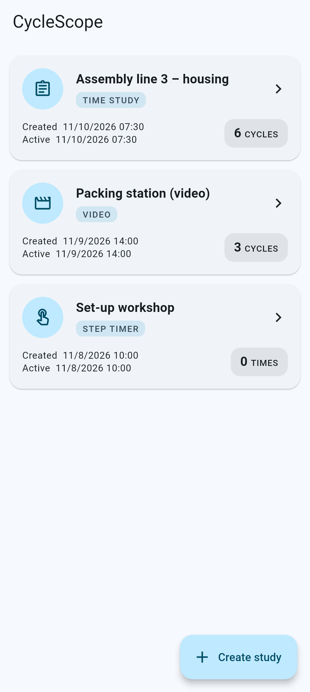 | 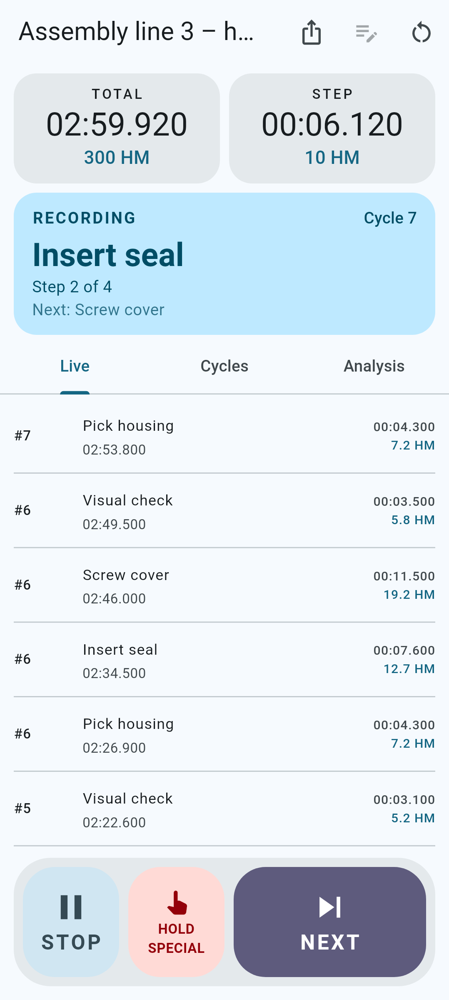 | 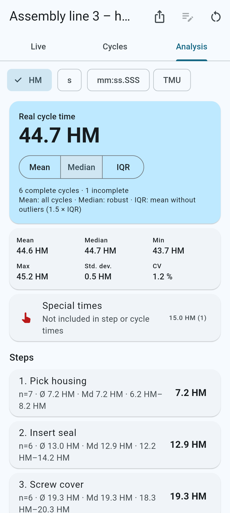 | 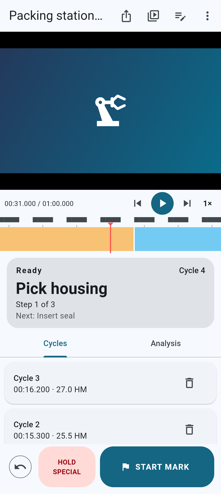 |

| New study | Cycles | Settings |
|---|---|---|
| 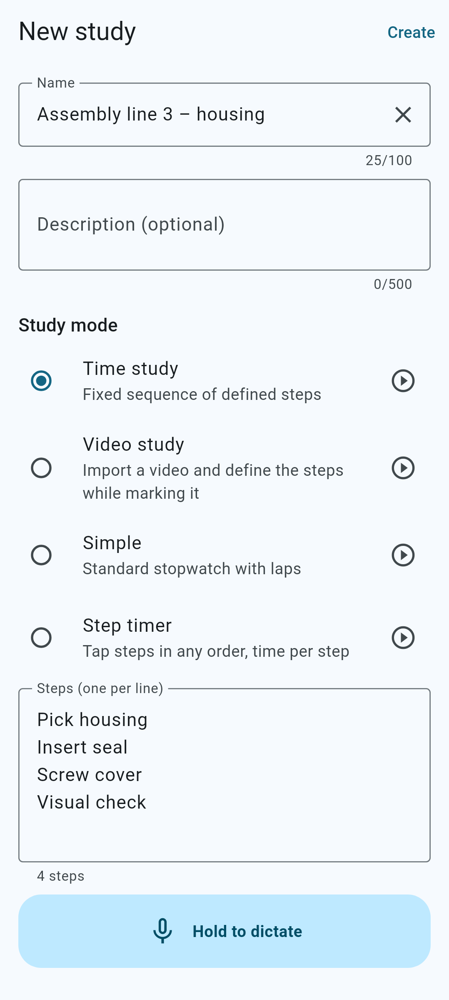 | 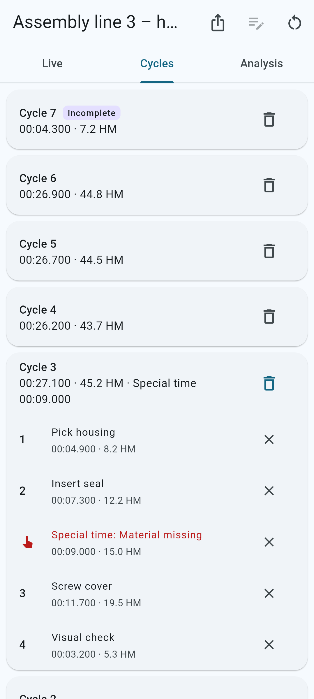 | 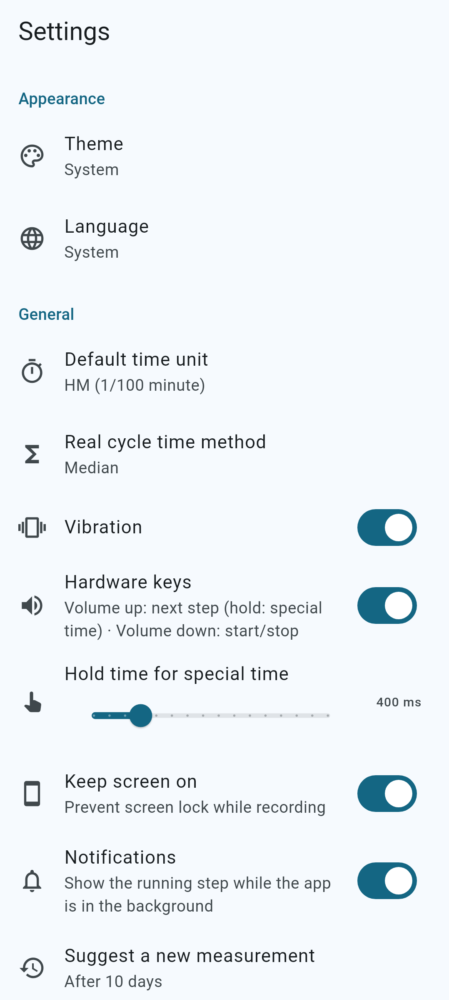 |

| Group | Revisions | Line analysis | Simulation |
|---|---|---|---|
| 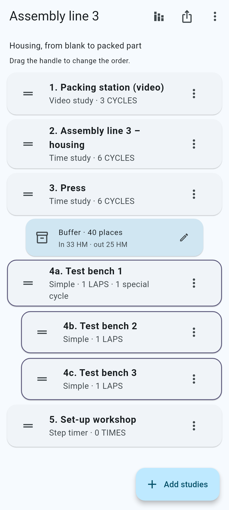 | 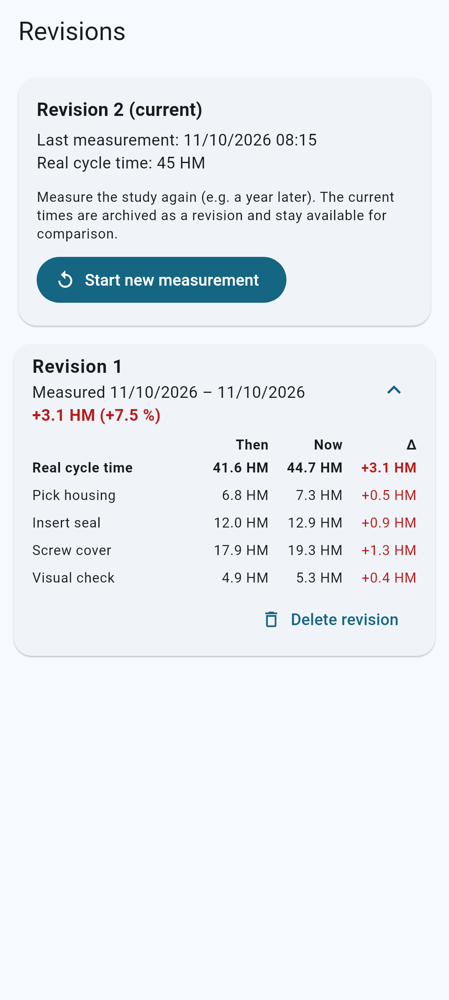 | 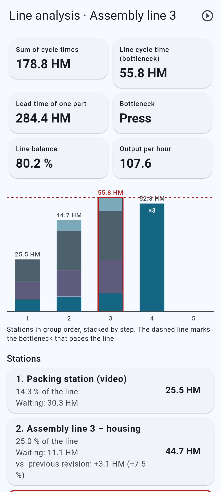 | 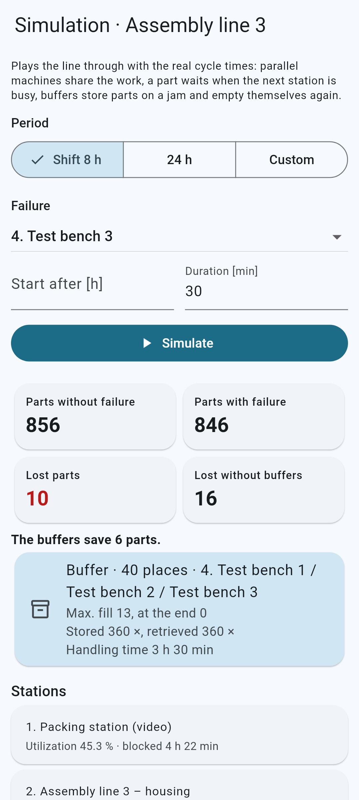 |
